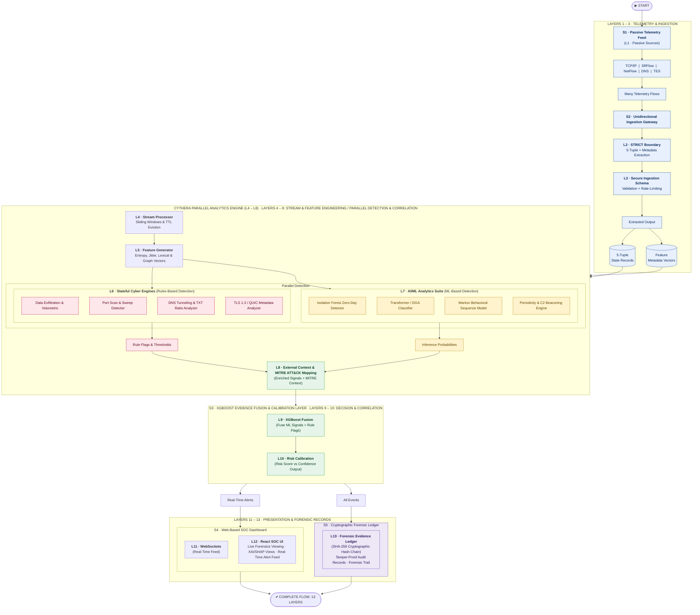
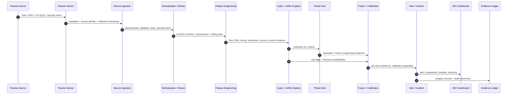
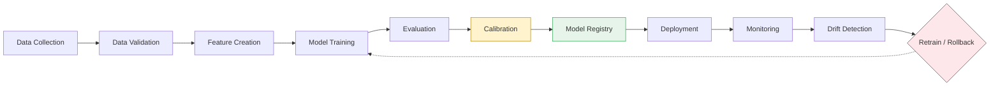
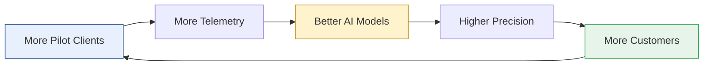
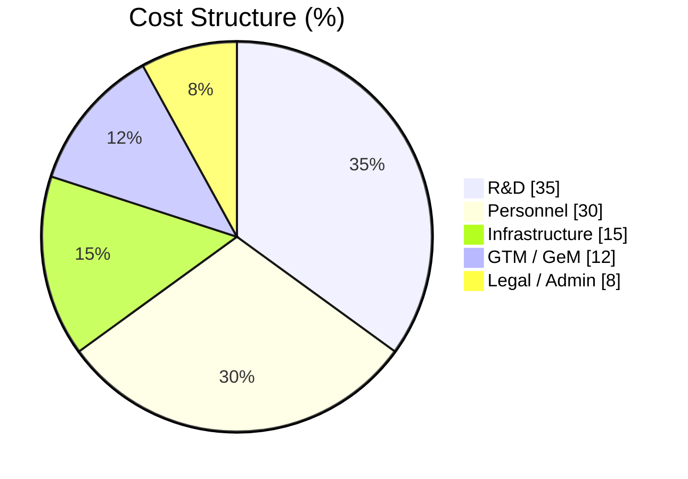

<div align="center">


<a href="https://git.io/typing-svg"></a>

<br/>

[](#-project-card)
[](#-project-card)
[](#-project-card)
[](#-team)


<br/>

**[Overview](#-overview) · [Architecture](#-architecture) · [Features](#-key-features) · [Detection](#-threat-coverage) · [Math](#-core-mathematical-formulations) · [Stack](#-technology-stack) · [Business](#-business-model) · [FAQ](#-faq)**

</div>

---

## 📑 Table of Contents

<details open>
<summary><b>Expand / collapse</b></summary>

1. [Project Card](#-project-card)
2. [Overview](#-overview)
3. [Why CYTHERA](#-why-cythera)
4. [Key Features](#-key-features)
5. [Threat Coverage](#-threat-coverage)
6. [Architecture](#-architecture)
   - [Proposed Architecture Diagram](#proposed-architecture-diagram)
   - [Key Functional Highlights](#key-functional-highlights)
   - [13-Layer Specification](#13-layer-specification)
   - [Complete Project Architecture (22 modules)](#complete-project-architecture-22-modules)
   - [End-to-End Processing Sequence](#end-to-end-processing-sequence)
   - [Example Detection Scenario](#example-detection-scenario)
7. [Core Mathematical Formulations](#-core-mathematical-formulations)
8. [Technology Stack](#-technology-stack)
9. [Internal Data Contracts](#-internal-data-contracts)
10. [Storage, Security & Resilience](#-storage-security--resilience)
11. [AI/ML Lifecycle & Governance](#-aiml-lifecycle--governance)
12. [Indian Regulatory & Compliance Alignment](#-indian-regulatory--compliance-alignment)
13. [Feasibility & Viability](#-feasibility--viability)
14. [Business Model](#-business-model)
15. [Impact & Benefits](#-impact--benefits)
16. [Competitive Analysis](#-competitive-analysis)
17. [Research, Datasets & References](#-research-datasets--references)
18. [User Roles](#-user-roles)
19. [Architectural Boundary](#-architectural-boundary)
20. [Roadmap](#-roadmap)
21. [Getting Started](#-getting-started)
22. [FAQ](#-faq)
23. [Team](#-team)

</details>

---

## 🪪 Project Card

| | |
|---|---|
| **Hackathon** | Smart India Hackathon 2026 |
| **Project** | CYTHERA — Passive AI/ML Network Threat Intelligence and Detection Platform |
| **Problem Statement ID** | `SIH26145` |
| **Problem Statement Title** | AI-Based Detection of Cyber Threats in Unidirectional IP Traffic |
| **Theme** | Blockchain & Cybersecurity |
| **PS Category** | Software |
| **Team ID** | `133474` |
| **Team Name** | Wannacry |
| **Repository** | [github.com/DevashyaManojbhaiJethva/CYTHERA](https://github.com/DevashyaManojbhaiJethva/CYTHERA) |

---

## 📌 Overview

**CYTHERA** is a software-only cybersecurity platform that converts passive network telemetry into **explainable, evidence-backed threat intelligence**.

It ingests read-only metadata from **TAP/SPAN mirrors, NetFlow/IPFIX records, DNS queries, and TLS/QUIC handshakes**, runs deterministic cyber engines and AI/ML models side by side, fuses the results into a calibrated **Risk Score** and **Confidence Score**, streams alerts to a **React SOC dashboard**, and preserves every decision in an **append-only, SHA-256 hash-chained forensic ledger**.

> **CYTHERA — Detect passively. Explain clearly. Preserve evidence.**

CYTHERA aims to support **earlier investigation** of C2 activity, DNS tunnelling and unusual network behaviour. Explainable alerts and correlated evidence help analysts understand *why* an observation needs attention.

### The three pillars of the solution

| 📡 Passive Telemetry Ingestion | ⚙️ Stateful Cyber Engines | 🧠 Multi-Engine AI Analytics |
|---|---|---|
| Ingests read-only metadata from TAP/SPAN mirrors, NetFlow/IPFIX records, DNS queries, and TLS/QUIC handshakes **without payload decryption**. | Deterministic rate and threshold analyzers for **Port Scanning, TCP SYN/UDP Floods, DNS Tunneling** (encoded labels & TXT ratios), and **Outbound Data Exfiltration**. | **Transformer DGA Classifier** for domain strings, **Markov Model** for sequence transitions, **Isolation Forest** for zero-day anomalies, and an **XGBoost Evidence Fusion Engine**. |

| 🧾 Tamper-Evident Forensic Ledger | 🖥️ Real-Time SOC Visibility | 🚫 Strict Unidirectional Boundary |
|---|---|---|
| Normalized events, features, and detection decisions preserved in an **append-only, SHA-256 hash-chained** evidence ledger for auditability. | Prioritized alerts, **SHAP** feature-contribution breakdowns, and **MITRE ATT&CK** mappings streamed to a React SOC dashboard via WebSockets. | Pure observation mode. **Never** injects packets, probes endpoints, blocks traffic, terminates sessions, or sends control signals into monitored networks. |

---

## 🎯 Why CYTHERA

| Problem in the field | CYTHERA's answer |
|---|---|
| Encrypted traffic (TLS 1.3 / QUIC) hides payloads | **Metadata-first inspection**: JA3/JA4 fingerprints, SNI, cipher suites, packet timing. No decryption needed. |
| Active probes can disrupt critical / air-gapped networks | **Strict unidirectional boundary**: read-only, non-interfering by design. |
| Black-box ML causes distrust and alert fatigue | **Explainable AI**: SHAP contributions, model versions, explicit evidence references on every alert. |
| One noisy detector floods the SOC | **Multi-signal corroboration** across rules, AI classifiers, and threat-intel context. |
| Severity and certainty get conflated | **Risk vs Confidence separation** with Platt-scaling calibration. |
| Evidence can be altered after the fact | **SHA-256 hash-chained ledger** with RBAC and immutable collection timestamps. |
| Telemetry leaving national boundaries | **Data sovereignty first**: fully on-prem or air-gapped. |

### 💡 Innovation and uniqueness

- **Risk vs Confidence Separation:** separates potential threat severity (Risk Score) from evidence certainty (Confidence Score) using Platt scaling calibration, preventing false-alarm fatigue on incomplete data.
- **Multi-Signal Corroboration:** decisions require agreement across independent cyber rules, AI classifiers, and threat-intelligence context rather than relying on a single black-box model.
- **Explainable AI (XAI) Design:** every alert includes top feature contributions, model versions, and explicit evidence references so analysts can verify the decision.

---

## ✨ Key Features

| | Feature | Details |
|:-:|---|---|
| 📡 | **Passive multi-source ingestion** | TCP/IP, NetFlow/IPFIX/sFlow, DNS, SRFlow & TES metadata, TLS/QUIC handshakes, firewall/IDS/auth events |
| 🔐 | **Zero payload inspection** | JA3/JA4, SNI, cipher suites, timing. TLS 1.3 / QUIC stay encrypted |
| 🛡️ | **Rule detection** | Exfiltration, volumetric anomalies, port scans, DNS tunneling, suspicious TLS/QUIC behavior |
| 🧠 | **AI/ML detection** | Finds unknown and abnormal behavioral patterns beyond predefined rules |
| 🔗 | **Context & correlation** | Maps activity to MITRE ATT&CK and connects related events into attack patterns |
| ⚖️ | **Risk fusion** | Combines rules + ML + context into calibrated risk / confidence scores |
| 🚨 | **Alert + evidence** | Real-time SOC alerts with SHA-256 hash-chained forensic evidence |
| 🏛️ | **Sovereign deployment** | On-premise / air-gapped operation with scalable parallel analytics |
| 🔍 | **Explainable alerts** | Top feature contributions (SHAP), model versions, evidence references |
| 📜 | **Versioned decisions** | Rules, models, feature schemas, TI snapshots, and decision policies are all versioned |

---

## 🕵️ Threat Coverage

<table>
<tr>
<th width="26%">🔒 Ransomware Command-and-Control (C2) Callbacks</th>
<th width="26%">📤 Stealthy DNS Data Exfiltration & Tunneling</th>
<th width="26%">🛰️ Internal Reconnaissance & Port Sweeps</th>
</tr>
<tr>
<td valign="top">

**Problem:** encrypted periodic callbacks.

**CYTHERA solution:** behavioral signature identification
- Callback periodicity
- Inter-arrival-time (IAT) jitter
- JA3/JA4 fingerprint anomalies
- Zero TLS payload decryption

</td>
<td valign="top">

**Problem:** encoded records inside outbound DNS queries bypass firewall detection.

**CYTHERA solution:** real-time DNS metadata analysis
- Query entropy
- Sub-domain depth & length
- TXT query ratios

</td>
<td valign="top">

**Problem:** lateral movement via IP/port sweeps (quiet scanning).

**CYTHERA solution:** stateful flow anomaly detection
- Destination fan-out
- Rate anomalies
- 5-tuple flow analysis
- Behavioral baseline

</td>
</tr>
</table>

**Full engine list:** DGA · DNS tunneling · beaconing / C2 · scanning & host sweeps · DDoS & traffic anomalies · exfiltration · protocol misuse · TLS/QUIC analytics · statistical anomaly rules.

---

## 🏗️ Architecture

### Proposed Architecture Diagram

Thirteen layers grouped into four stages. Telemetry flows one way only.



<details>
<summary><b>📖 Diagram legend: layer groups</b></summary>

| Group | Layers | Role |
|---|---|---|
| **Telemetry & Ingestion** | 1 – 3 | Passive sources, unidirectional gateway, strict boundary, secure ingestion schema |
| **Stream & Feature Engineering / Parallel Detection & Correlation** | 4 – 8 | Stream processor, feature generator, parallel rule + ML engines, ATT&CK context |
| **Decision & Correlation** | 9 – 10 | XGBoost fusion and risk / confidence calibration |
| **Presentation & Forensic Records** | 11 – 13 | WebSocket feed, React SOC UI, cryptographic forensic ledger |

</details>

### Key Functional Highlights

| # | Stage | What happens |
|:-:|---|---|
| 1 | **Passive Ingestion** | TCP/IP, NetFlow, DNS, SRFlow & TES metadata collected without payload inspection |
| 2 | **Rule Detection** | Flags exfiltration, volumetric anomalies, port scans, DNS tunneling & suspicious TLS/QUIC behavior |
| 3 | **AI/ML Detection** | Finds unknown and abnormal behavioral patterns beyond predefined rules |
| 4 | **Context & Correlation** | Maps activity to MITRE ATT&CK and connects related events into attack patterns |
| 5 | **Risk Fusion** | Combines rules + ML + context into calibrated risk / confidence scores |
| 6 | **Alert + Evidence** | Sends real-time SOC alerts and preserves SHA-256 hash-chained forensic evidence |
| 7 | **Sovereign Deployment** | Supports on-premise / air-gapped operation with scalable parallel analytics |

### 13-Layer Specification

<details>
<summary><b>Click to expand the full reference architecture</b></summary>

```text
+----------------------------------------------------------------------------------+
|                         CYTHERA SOC PLATFORM                                     |
|              Passive AI/ML Network Threat Intelligence                          |
+----------------------------------------------------------------------------------+
| L1  PASSIVE NETWORK SOURCES   TAP/SPAN | NetFlow/IPFIX/sFlow | DNS | TLS/QUIC    |
|                               Firewall/IDS | Auth Logs                           |
| L2  PASSIVE SENSOR/COLLECTOR  Flow extraction | Timestamping | Source identity   |
| L3  SECURE INGESTION          Auth | TLS | Schema validation | Replay protection |
| L4  NORMALIZATION & STREAM    Common schema | Dedup | Windows | TTL eviction    |
| L5  FEATURE ENGINEERING       Flow | DNS | Timing | Graph | TLS/QUIC | Rarity    |
| L6  SPECIALIZED DETECTION     DGA | Tunneling | Beaconing | Scan | DDoS | Exfil   |
| L7  AI/ML ANALYTICS           Transformer DGA | Markov | Periodicity | IsoForest |
| L8  THREAT-INTEL CORROBORATION Reputation | IOC | Domain/IP intel | TI snapshots|
| L9  EVIDENCE FUSION & DECISION Agreement | Temporal | Asset | History | Quality  |
| L10 RISK & CONFIDENCE         Risk | Confidence | Calibration | Escalation      |
| L11 ALERT & INCIDENT MGMT     Prioritize | Correlate | Timeline | Assign | Audit  |
| L12 SOC DASHBOARD             Overview | Alert center | Graph | XAI | Reports    |
| L13 STORAGE & LEDGER          DB | Event store | Objects | Hash chain | RBAC     |
+----------------------------------------------------------------------------------+
```

| # | Layer | Responsibilities |
|:-:|---|---|
| **1** | Passive Network Sources | TAP/SPAN metadata · NetFlow/IPFIX/sFlow · DNS queries & responses · TLS/QUIC handshake metadata · firewall, IDS, IPS, proxy, gateway logs · authentication & security-event streams |
| **2** | Passive Sensor & Metadata Collector | Flow extraction · metadata parsing · timestamping · sensor identity · sequence numbering · basic validation · collection-health monitoring. Stays lightweight: no heavy AI, no scanning, no injection, no blocking, no decryption |
| **3** | Secure Ingestion | Sensor authentication · TLS · schema validation · freshness & sequence checks · replay protection · rate limiting · queueing · backpressure · malformed-event isolation |
| **4** | Normalization & Stream Processing | Field, timestamp & protocol normalization · deduplication · missing-value handling · time windows · rolling aggregates · TTL-based state eviction · provenance preservation |
| **5** | Feature Engineering | Flow · DNS lexical/statistical · timing & periodicity · behavioral relationship · TLS/QUIC metadata · volume & rarity features. Same features for real-time inference and offline evaluation |
| **6** | Specialized Detection Engines | DGA · DNS tunneling · beaconing/C2 · scanning & host sweeps · DDoS & traffic anomaly · exfiltration · protocol misuse · TLS/QUIC analytics. Each returns detector name, score, threshold, indicators, time window, event refs |
| **7** | AI/ML Analytics | Transformer DGA classifier · Markov behavior model · periodicity model · Isolation Forest · optional supervised models · version tracking. AI outputs are *evidence inputs*, never unexplained final decisions |
| **8** | Threat-Intel Corroboration | Domain/IP reputation · known IOCs · historical sightings · campaign / actor context · IOC source, confidence, expiry · cached TI snapshots. Supports a decision, never establishes maliciousness alone |
| **9** | Evidence Fusion & Decision Engine | Detector agreement · temporal consistency · asset criticality · historical behavior · TI support · data quality · model outputs · evidence completeness |
| **10** | Risk & Confidence Calibration | Risk score · confidence score · calibration · uncertainty · escalation logic |
| **11** | Alert & Incident Management | Alert creation · prioritization · severity & status · correlation · incident timeline · assignment · analyst notes · evidence attachment · closure reason · audit history |
| **12** | SOC Dashboard & Presentation | Live network overview · alert center · incident timeline · communication graph · AI explanation view · evidence viewer · system health · reports & exports (authenticated REST + WebSockets) |
| **13** | Storage, Evidence Ledger & Governance | Relational DB · time-series/event store · object storage · cache/state store · hash chaining · append-only evidence · model registry · retention, backup, access control, recovery |

**Decision states:** `NORMAL` · `SUSPICIOUS` · `MALICIOUS` · `UNKNOWN_ANOMALY` · `INSUFFICIENT_EVIDENCE` · `ESCALATE`

**Traceability:** every alert links back to the source event, feature set, detector output, model version, and decision.

</details>

### Complete Project Architecture (22 modules)

<details>
<summary><b>Click to expand the full module map</b></summary>

| Group | # | Module |
|---|:-:|---|
| **Sense** | 1 | Observation & Data Sources (TAP/SPAN, packet metadata, NetFlow/IPFIX/sFlow, DNS, TLS/QUIC, existing security streams) |
| | 2 | Passive Sensor Layer |
| | 3 | Secure Data Ingestion (gateway, validation, source auth, replay protection, rate limiting, secure event bus) |
| **Process** | 4 | Normalization & Stream Processing (normalizer, 5-tuple flow/session builder, window manager) |
| | 5 | Feature Engineering Layer |
| **Detect** | 6 | Cyber Detection Engines |
| | 7 | AI / ML Intelligence Layer |
| | 8 | External Corroboration |
| **Decide** | 9 | Evidence Fusion & Decision Engine |
| | 10 | Risk, Confidence & Calibration |
| | 11 | Explainability & Evidence |
| **Respond (human-in-the-loop)** | 12 | Alert & Event Management |
| | 13 | Incident Correlation |
| | 14 | Evidence Integrity & Audit |
| | 15 | Cyber Knowledge & Context |
| **Platform** | 16 | Backend Platform |
| | 17 | Data Storage Layer |
| | 18 | SOC Dashboard / Frontend |
| **Operate** | 19 | Model Operations & MLOps |
| | 20 | Security & Governance |
| | 21 | Observability & Reliability |
| | 22 | Testing & Verification |

**Complete data flow**

```text
Passive Network Observation
        ▼
Passive Sensor
        ▼
Secure Ingestion
        ▼
Validation and Normalization
        ▼
Flow / Session / Window Processing
        ▼
Feature Engineering
        ▼
Cyber Detection Engines
   ├── DNS / DGA / DNS Tunneling
   ├── Markov / C2 / Beaconing
   ├── DDoS / Reconnaissance
   ├── Exfiltration
   └── TLS / QUIC Metadata
        ▼
AI/ML Intelligence
   ├── DGA Transformer
   ├── Markov Model
   ├── Periodicity Analysis
   ├── Isolation Forest
   └── XGBoost Fusion
        ▼
External Corroboration
        ▼
Evidence Fusion
        ▼
Threat Decision
        ▼
Risk + Confidence + Calibration
        ▼
Explainable Alert
        ▼
Incident Correlation
        ▼
Evidence Ledger and Audit Trail
   ├── Backend APIs
   ├── WebSockets
   ├── Database
   ├── Model Registry
   └── SOC Dashboard
```

> Lab / simulation / PCAP-generation is **not** a CYTHERA subsystem. Controlled datasets are used only as external training and evaluation inputs.

</details>

### End-to-End Processing Sequence



### Example Detection Scenario

<details>
<summary><b>DNS-based command-and-control walkthrough</b></summary>

1. An internal host sends repeated DNS queries to unusual, **high-entropy** domains.
2. The sensor records domain names, query types, response codes, timestamps, source host, and resolver information.
3. Normalization creates a common event record.
4. Feature engineering computes domain entropy, label length, unique-subdomain count, query rate, and timing regularity.
5. The **DGA engine** flags generated-looking names; the **DNS tunneling engine** flags long/encoded labels; the **periodicity engine** flags repeated callbacks.
6. The **AI/ML layer** evaluates the domain and behavior sequence.
7. **Threat intelligence** adds reputation or historical context if available.
8. **Evidence fusion** weighs detector agreement, timing, host history, data quality, and TI support.
9. The platform emits **separate risk and confidence** values.
10. An **explainable alert** is created, linked to supporting events and model versions.
11. Related alerts are grouped into an **incident** and shown in the SOC dashboard.
12. Evidence hashes and audit records are stored for later investigation.

</details>

---

## 🧮 Core Mathematical Formulations

| # | Formulation | Formula | Purpose |
|:-:|---|---|---|
| 1 | **Domain Shannon Entropy** (lexical DGA & tunneling detection) | $H(D) = -\sum_i P(x_i)\,\log_2 P(x_i)$ | Quantifies character randomness in domain labels to identify algorithmically generated domains |
| 2 | **Beaconing Inter-Arrival Time Variance** (C2 polling detection) | $\sigma_{IAT} = \sqrt{\frac{1}{N}\sum_{k}(IAT_k-\mu_{IAT})^2}$ | Detects automated C2 polling by identifying ultra-low timing jitter ($\sigma_{IAT}\to 0$) |
| 3 | **Markov Behavioral Transition Probability** | $P(S) = \prod_t P(s_t \mid s_{t-1})$ | Evaluates likelihood of state-transition sequences against historical communication baselines |
| 4 | **Calibrated Risk Fusion Score** (XGBoost + Platt scaling) | $R = \dfrac{1}{1+e^{-(W^{\top}E+b)}}$ | Fuses independent rule flags and ML probability vectors into a calibrated risk score |
| 5 | **Cryptographic Hash Chain** (evidence ledger auditability) | $H_k = \text{SHA-256}(E_k \,\Vert\, H_{k-1})$ | Enforces immutable evidence provenance across all forensic event logs and decision records |

---

## 🧰 Technology Stack

| Layer | Tools | Role |
|---|---|---|
| **1 · Ingestion & Stream Processing** | Python 3.12 · DPDK · Scapy · 5-Tuple Flow Aggregation | Data processing / ETL pipelines / APIs · high-performance packet processing · packet parsing & protocol dissection · flow extraction & summarization |
| **2 · Feature Engineering Pipeline** | NumPy · Pandas · Entropy & Arrival Jitter · NetworkX · Graph Analytics | Numerical computing · data manipulation · traffic behavior features & statistical metrics · graph modeling · visualization & pattern discovery |
| **3 · AI / ML & Core Analytics Suite** | PyTorch · scikit-learn · XGBoost · Custom Models | Transformer & DGA classifier · Isolation Forest & Markov state models · multi-signal fusion · multi-modal evidence discovery |
| **4 · Storage & Evidence Infrastructure** | Redis · PostgreSQL · SHA-256 Hash Chain Engine | In-memory cache & session management · event logs, metadata & evidence storage · immutable audit trail & data integrity |
| **5 · API & Presentation Layer** | FastAPI · WebSockets · React.js · Tailwind CSS · Dashboard UI | REST API gateway · real-time streaming & live updates · modern responsive UI · utility-first styling · interactive role-based visualization |

Also referenced: **Zeek** for passive TAP/SPAN protocol log generation.

---

## 📦 Internal Data Contracts

Versioned, structured objects flow between layers (JSON, Avro, Protobuf, or any validated schema; the logical fields below are preserved).

| Object | Required logical fields |
|---|---|
| **Raw / Source Event** | `event_id` `source_id` `collection_timestamp` `source_type` `raw_reference` `payload_metadata` `sequence` |
| **Normalized Event** | `event_id` `event_type` `timestamp` `src` `dst` `src_port` `dst_port` `protocol` `bytes` `packets` `provenance` |
| **Feature Record** | `feature_id` `event_id`/`window_id` `feature_schema_version` `feature_values` `calculation_timestamp` |
| **Detection Result** | `detector_id` `detector_version` `score` `threshold` `decision` `indicators` `time_window` `evidence_refs` |
| **ML Result** | `model_id` `model_version` `feature_schema_version` `prediction` `probability` `uncertainty` `explanation_refs` |
| **TI Result** | `indicator` `source` `reputation` `confidence` `first_seen` `last_seen` `expiry` `snapshot_id` |
| **Fused Decision** | `decision_id` `risk` `confidence` `state` `contributing_signals` `policy_version` `evidence_refs` |
| **Alert** | `alert_id` `severity` `risk` `confidence` `type` `source` `destination` `status` `created_at` `decision_id` |
| **Incident** | `incident_id` `related_alerts` `timeline` `entities` `status` `owner` `notes` `closure_reason` |
| **Evidence Record** | `evidence_id` `source_reference` `content_hash` `previous_hash` `timestamp` `version` `access_log_ref` |

---

## 🔐 Storage, Security & Resilience

<table>
<tr>
<td valign="top" width="33%">

### 🗄️ Storage & Evidence

- **Relational DB:** users, roles, permissions, alerts, incidents, configuration, model registry, audit metadata
- **Event store:** normalized events, flow metrics, detector measurements, rolling aggregates
- **Object storage:** evidence bundles, reports, snapshots, model artifacts, TI snapshots
- **Cache / state:** detector windows, rate limits, dedup keys, temporary correlation state
- **Evidence ledger:** evidence IDs, timestamps, source refs, content hashes, previous hashes, model versions, decision refs

</td>
<td valign="top" width="33%">

### 🛡️ Security

- RBAC for admins, analysts, researchers, viewers
- TLS for sensor-to-platform and service-to-service
- Sensor authentication & credential rotation
- Secrets kept out of source code
- Strict schema validation & input sanitization
- Rate limiting, replay protection, abuse monitoring
- Audit logging (auth, access, config, alert changes, evidence ops)
- Metadata minimization & controlled retention
- Restricted evidence access & authorized export
- Versioned models, rules, features, decisions, TI snapshots

</td>
<td valign="top" width="33%">

### ♻️ Resilience

- Buffering & backpressure in ingestion
- Bounded state via windows, TTL eviction, resource limits
- A malformed event never stops the pipeline
- Health, readiness, latency, throughput, queue-depth, error metrics
- Replay of recorded telemetry for testing & investigation
- Visible health signals on storage failure; no silent evidence loss
- Model-load failures isolated, controlled degraded mode
- Config & model rollback
- Alert / evidence records durable before "stored" is reported

</td>
</tr>
</table>

---

## 🤖 AI/ML Lifecycle & Governance



- Track **precision, recall, F1-score, false-positive rate, detection latency**, and category-level performance.
- Evaluate **calibration separately** from classification accuracy.
- Monitor feature and behavior drift.
- Store model versions, feature schemas, training info, evaluation results, and rollback metadata.
- Link each inference to the model and feature versions used.
- Never deploy a model without a defined fallback or degraded-mode behavior.

---

## 🇮🇳 Indian Regulatory & Compliance Alignment

| Mandate | How CYTHERA aligns |
|---|---|
| **CERT-In 6-Hour Mandate Ready** | Meets national cyber response guidelines with near-real-time detection and rapid incident export for mandatory reporting |
| **RBI & DPDP Act Auditability** | Append-only SHA-256 evidence ledger provides court-admissible, tamper-evident forensic chains of custody without inspecting or storing sensitive private payload data |
| **Data Sovereignty First** | Deploys fully on-premise or in air-gapped networks, keeping all network telemetry inside national and institutional boundaries |

---

## 🧪 Feasibility & Viability

<table>
<tr>
<td valign="top" width="50%">

### Feasibility

- **Established open-source stack:** Python 3.12, Zeek, PyTorch, Scapy, XGBoost for reliable stream processing and model inference.
- **Passive metadata ingestion:** standard TAP/SPAN mirrors and NetFlow/IPFIX exports; no endpoint agents or active network modifications.
- **Bounded processing pipeline:** Redis sliding time windows and TTL state eviction manage high-throughput flows without memory leaks or buffer overflows.
- **Modular microservice architecture:** ingestion, feature engineering, cyber rules, and AI analytics are isolated services for independent testing and targeted upgrades.

</td>
<td valign="top" width="50%">

### Operational & Economic Viability

- **Zero infrastructure cost:** pure software over existing mirror ports; no extra hardware appliances or endpoint agent licences.
- **Reduced analyst alert fatigue:** multi-signal fusion and Platt scaling separate Risk from Confidence.
- **On-prem & air-gapped compliance:** telemetry never leaves local boundaries.
- **Explainable AI investigation:** evidence-backed alerts with top feature contributions and MITRE ATT&CK mappings.
- **Immutable forensic integrity:** event logs, feature vectors, and decisions sealed in an append-only SHA-256 hash ledger.

</td>
</tr>
</table>

### ⚠️ Challenges → Strategies

| Potential challenge / risk | Strategy for overcoming |
|---|---|
| **High traffic volume & memory pressure** | **Bounded processing windows & reactive backpressure.** DPDK/Scapy stream micro-batching, reactive queue backpressure, bounded sliding windows in an in-memory Redis state store; TTL-based eviction flushes inactive 5-tuple flows, guaranteeing bounded RAM without packet drops. |
| **Encrypted or unavailable metadata** | **Metadata-first inspection.** JA3/JA4 fingerprints, SNI, cipher suites, and packet timing carry the detection; no payload dependency. Missing fields lower *Confidence* rather than forcing a verdict. |
| **False positives & alert overload** | **Calibrated multi-signal fusion & incident correlation.** XGBoost evidence fusion over rules and ML probabilities; Platt scaling separates Risk from Confidence; entity baselines, alert dedup, and unified incident timelines. |
| **Model drift & unfamiliar behaviour** | **Shadow MLOps & continuous drift monitoring.** Monitor input feature distributions; evaluate retrained candidates on held-out benchmarks (CICIDS2017 & CTU-13); deploy in shadow mode with version-tracked registries and instant rollback. |
| **Evidence tampering / incomplete provenance** | **SHA-256 hash-chained evidence ledger.** Links raw metadata references, normalized events, feature snapshots, and decision records in an append-only chain; strict RBAC and immutable collection timestamps. |

---

## 💼 Business Model

### 1 · Customer segments & buyer vs user

| Segment | Target / note |
|---|---|
| 🎓 **Educational campuses** | Pilot target: ₹1.5L/yr approx. |
| 🏦 **Regional co-op banks & FinTechs** | RBI compliance: ₹3.5L – ₹5.0L/yr approx. |
| 🚀 **Mid-market enterprises & tech startups (SMBs)** | Enhanced security tier |
| 🏛️ **Government offices & PSUs** | On-premise / GeM |

| **Buyers** | **Users** |
|---|---|
| CISO / CIO: reduce risk & cost | SOC analysts: fast triage, explainable SHAP views |

### 2 · Operational lifecycle

`Integrate` → `Observe` → `Detect` → `Explain` → `Correlate` → `Investigate` → `Report` → `Improve`

### 3 · Proposed revenue model (INR)

| Tier | Description | Pricing |
|---|---|---|
| **Starter** | Basic security | ₹1.5L/yr approx. |
| **Professional** | Enhanced security | ₹3.5L/yr approx. |
| **Enterprise** | Comprehensive | ₹6.0L/yr approx. |
| **Govt** | On-premise / GeM | ₹10.0L/yr approx. |
| **MSSP** | Partner pricing | ₹20.0L/yr approx. |

**Additional revenue streams:** setup fees (₹25k – ₹50k approx.) · 24/7 support (20%) · VAPT services · threat-intel feeds.

### 4 · Land-and-expand strategy

| Phase 1 | Phase 2 | Phase 3 | Phase 4 |
|---|---|---|---|
| Core Detection | Platform Adoption | Advanced Analytics | AI Security Intelligence |

### 5 · Go-to-market

Direct campus sales · GeM portal procurement · MSSP partnerships · ecosystem integrations.

### 6 · Business flywheel



### 7 · Key business metrics (KPIs)

| Metric | Y1 (Pilot) | Y2 (Growth) | Y3 (Scale) | Trend |
|---|---|---|---|:-:|
| **ARR** (Annual Recurring Revenue) | ₹8.5L approx. | ₹48L approx. | ₹1.65 Cr approx. | 🟢 ↑ |
| **CAC** (Customer Acquisition Cost) | ₹3.5k approx. | ₹60k approx. | ₹85k approx. | 🔴 ↑ |
| **LTV** (Lifetime Value) | ₹4.5L approx. | ₹9.6L approx. | ₹18L approx. | 🟢 ↑ |
| **Gross margin** | 82% | 85% | 88% | 🟢 ↑ |
| **LTV / CAC** | 12.8x | 16.0x | 21.1x | 🟢 ↑ |

### 8 · Cost structure



---

## 🌍 Impact & Benefits

### Potential impact on the target audience

| Audience | Impact |
|---|---|
| **🏢 Enterprise SOCs** | **Accelerated triage:** prioritized alerts, SHAP breakdowns, correlated threat timelines. **Reduced fatigue:** Platt-calibrated scoring filters weak evidence so analysts focus on genuine critical threats. |
| **🏛️ Government & Critical National Infrastructure (CNI)** | **Continuity-first monitoring:** continuous detection where active scanning or downtime is prohibited. **Air-gapped operation:** telemetry stays local, satisfying strict national compliance mandates. |
| **🛠️ MSSPs** | **Multi-tenant scalability:** standardized evidence collection and incident workflows across diverse customer networks. **Standardized ATT&CK view:** consistent customer reporting. |
| **🎓 Academic & research institutions** | **Reproducible experiments:** versioned feature schemas and dataset evaluation pipelines enable structured threat research and analyst training. |

### Multidimensional benefits

| Dimension | Benefit |
|---|---|
| **Operational & economic** | **Zero hardware overhead:** software over existing TAP/SPAN and flow records. **Automated correlation:** replaces manual log cross-referencing with multi-signal fusion and incident correlation. |
| **Auditability & legal provenance** | **Cryptographic tamper-evidence:** SHA-256 chaining keeps detection records, model versions, and raw observations immutable for forensics and audits. **Explainable AI decisions:** evidence-backed justification for every escalated alert. |
| **Privacy & network safety** | **Zero operational disruption:** pure one-way read-only boundary; never injects packets, terminates sessions, or alters firewall rules. **Metadata-first privacy:** inspects handshake patterns and timing without invasive decryption. |

---

## 🥊 Competitive Analysis

| Competitor | Platform focus | Architectural overlap | CYTHERA strategic differentiation |
|---|---|---|---|
| **AutoCops (Netgraph)** | NDR & security knowledge graph (SIEM / EDR / UEBA / SOAR) | **High:** flow/protocol analytics, TAP/SPAN sensors, baseline anomaly detection, MITRE ATT&CK mapping | Explainable AI feature contribution scores and an immutable SHA-256 evidence ledger, without requiring full XDR stack replacement |
| **Sparaka Networks** | Autonomous AI SOC (Sphere) & passive OT/ICS monitoring (Signal) | **High:** passive telemetry collection, AI detection, multi-signal correlation, incident triage | Vendor-agnostic enterprise telemetry, explainable detection, and evidence preservation rather than broad autonomous intervention |
| **BluSapphire** | Unified AI SOC, SIEM / EDR / SOAR & managed operations | **Medium:** ML anomaly detection, threat-intel correlation, SOC investigation workflows | Non-intrusive decision and evidence layer across existing tools, not a replacement for the whole enterprise security stack |
| **Jio NetSensor** | Telecom-scale network traffic monitoring & threat analytics | **Medium:** network telemetry, anomaly detection, lateral-movement tracking, compromised-asset identification | Vendor-neutral deployment (cloud, hybrid, air-gapped / sovereign) independent of telecom carrier infrastructure |
| **Cryptus Cyber Security** | AI/ML-driven Network Detection & Response (NDR) | **High:** behavioral traffic analysis, encrypted metadata inspection, lateral-movement detection | Platt-scaled probability calibration, cryptographic evidence provenance, and human-in-the-loop workflows |

---

## 📚 Research, Datasets & References

### Methods & platform foundations

| Reference | Used for |
|---|---|
| [**Zeek Network Security Monitor**](https://docs.zeek.org/en/current/about/monitoring.html) | Passive TAP/SPAN packet-mirror extraction and protocol log generation |
| [**Vaswani et al. (2017)**, *Attention Is All You Need*](https://arxiv.org/abs/1706.03762) | Architectural foundation for the character-level Transformer DGA classifier |
| [**Chen & Guestrin (2016)**, *XGBoost: A Scalable Tree Boosting System*](https://arxiv.org/abs/1603.02754) | ML foundation for multi-signal evidence fusion and risk scoring |
| [**Liu, Ting & Zhou (2008)**, *Isolation Forest*](https://doi.org/10.1109/ICDM.2008.17) | Anomaly detection for unknown zero-day traffic deviations |
| [**DPDK**](https://www.dpdk.org) | High-speed user-space packet processing for gigabit line-rate flow ingestion |
| [**PyTorch**](https://pytorch.org) | Transformer inference and vector operations |

### Proposed evaluation & benchmark datasets

| Dataset | Description |
|---|---|
| [**CICIDS2017**](https://www.unb.ca/cic/datasets/ids-2017.html) (Univ. of New Brunswick) | Real-world benign traffic and modern attack vectors (DDoS, scanning, infiltration) |
| [**CTU-13**](https://www.stratosphereips.org/datasets-ctu13) (Stratosphere Laboratory) | Real botnet traffic, C2 beaconing, DNS communication streams |
| [**UNSW-NB15**](https://research.unsw.edu.au/projects/unsw-nb15-dataset) | Hybrid real low-footprint attacks and synthetic traffic vectors |
| [**CAIDA Anonymized Internet Traces**](https://www.caida.org/catalog/datasets/) | Passive traffic metrics and volumetric flow analysis |

### Threat frameworks & industry standards

| Standard | Purpose |
|---|---|
| [**MITRE ATT&CK Enterprise**](https://attack.mitre.org) | Adversary tactics, techniques, and procedures (TTPs) |
| [**IETF RFC 7011 (IPFIX)**](https://datatracker.ietf.org/doc/html/rfc7011) | Standard protocol for IP flow information export |
| [**IETF RFC 8446 (TLS 1.3)**](https://datatracker.ietf.org/doc/html/rfc8446) | Encrypted transport handshakes and metadata inspection |
| [**JA4+ Fingerprinting**](https://github.com/FoxIO-LLC/ja4) | TLS/QUIC client and session fingerprinting without payload decryption |
| [**NIST SP 800-94**](https://csrc.nist.gov/publications/detail/sp/800-94/final) | Federal guidelines for passive network monitoring and event correlation |

---

## 👥 User Roles

| Role | Typical permissions | Responsibilities |
|---|---|---|
| 👑 **Administrator** | Manage users, roles, configuration, models, system settings | Maintain platform security and availability |
| 🕵️ **SOC Analyst** | View alerts/incidents, investigate evidence, add notes, assign & close incidents | Validate and investigate suspicious activity |
| 🔬 **Researcher** | Access approved datasets, models, metrics, reports | Evaluate detection quality and improve analytics |
| 👀 **Read-only Viewer** | View authorized dashboards and reports | Monitor status without modifying records |
| 🤖 **System Service** | Machine-to-machine access under least privilege | Process events and maintain workflows |

---

## 🚧 Architectural Boundary

The following boundary is **mandatory** and holds in every implementation phase.

| ✅ CYTHERA MAY | ⛔ CYTHERA MUST NOT |
|---|---|
| Receive existing passive telemetry | Actively scan or probe |
| Parse and normalize metadata | Initiate suspicious handshakes |
| Calculate features and behavioral statistics | Inject, modify, or replay packets |
| Run rules and AI/ML models | Block traffic automatically |
| Correlate threat intelligence | Terminate sessions |
| Generate explainable alerts and incidents | Change firewall or endpoint configurations |
| Preserve evidence and provide analyst recommendations | Send response commands to monitored assets |
| | Depend on payload decryption as a requirement |

**Also out of scope:** active network discovery / vulnerability scanning · treating a single threat-intel hit as conclusive proof.

### 🏛️ Architectural principles

| Principle | Meaning |
|---|---|
| Passive-only operation | Consumes existing telemetry; never initiates network interaction |
| Read-only monitoring | Never modifies packets, routes, configs, or endpoint state |
| One-directional data flow | Telemetry in; no response commands out toward monitored assets |
| Metadata-first analysis | Detection relies on metadata, statistics, timing, relationships |
| Explainability by design | Every meaningful alert carries reasons, features, detector contributions, evidence refs |
| Evidence preservation | Raw refs, events, features, outputs, decisions stay traceable |
| Risk-confidence separation | Threat level and evidence reliability are independent |
| Modularity | Collection, processing, analytics, storage, APIs, presentation are separate |
| Human oversight | Analysts validate, investigate, assign, and close incidents |
| Versioned decisions | Rules, models, schemas, TI snapshots, policies are versioned |

---

## 🗺️ Roadmap

Mirrors the land-and-expand strategy.

- [ ] **Phase 1 · Core Detection:** passive ingestion, stateful cyber engines, SOC alert feed
- [ ] **Phase 2 · Platform Adoption:** incident correlation, RBAC, evidence ledger, reports & exports
- [ ] **Phase 3 · Advanced Analytics:** Transformer DGA, Markov, Isolation Forest, XGBoost fusion, SHAP views
- [ ] **Phase 4 · AI Security Intelligence:** shadow MLOps, drift monitoring, multi-tenant MSSP scale

---

## 🚀 Getting Started

**Prerequisites**

| Component | Version / note |
|---|---|
| Python | 3.12 |
| Redis | state store and sliding windows |
| PostgreSQL | events, metadata, evidence storage |
| Node.js | React SOC dashboard |
| Traffic source | TAP/SPAN mirror port or NetFlow/IPFIX exporter |

<!-- Add clone / install / run commands here once the repo layout is final. -->

```bash
git clone https://github.com/DevashyaManojbhaiJethva/CYTHERA.git
cd CYTHERA
```

---

## ❓ FAQ

<details>
<summary><b>Does CYTHERA decrypt TLS traffic?</b></summary>

No. It uses observable metadata only: JA3/JA4 fingerprints, SNI, cipher suites, and packet timing. TLS 1.3 and QUIC stay encrypted.

</details>

<details>
<summary><b>Will it block or interfere with my network?</b></summary>

No. It is strictly read-only and one-directional. It never injects packets, probes endpoints, blocks traffic, terminates sessions, or changes firewall or endpoint configuration.

</details>

<details>
<summary><b>Why separate Risk and Confidence?</b></summary>

Risk is how severe a threat could be; Confidence is how certain the evidence is. Keeping them apart (Platt-calibrated) stops incomplete data from triggering high-priority false alarms.

</details>

<details>
<summary><b>Does a threat-intel hit alone raise an alert?</b></summary>

No. Threat intelligence is supporting evidence. Decisions need agreement across cyber rules, AI classifiers, and TI context.

</details>

<details>
<summary><b>Where does the "blockchain" part come in?</b></summary>

The forensic ledger is an append-only, SHA-256 hash-chained record (H<sub>k</sub> = SHA-256(E<sub>k</sub> ∥ H<sub>k-1</sub>)) so any alteration of events, features, or decisions is detectable.

</details>

<details>
<summary><b>Can it run air-gapped?</b></summary>

Yes. It deploys fully on-premise or in air-gapped networks, and all telemetry stays inside institutional and national boundaries.

</details>

---

## 👨‍💻 Team
<div align="center">

**Team Wannacry** · Team ID `133474` · Smart India Hackathon 2026

| Role | Name |
|---|---|
| **Team Leader** | Devashya Jethva |
| **Team Member** | Manthan Satishkumar Balani |
| **Team Member** | Neil Sandeep Banerjee |
| **Team Member** | Chauhan Rajvardhansingh Narendrasingh |
| **Team Member** | Yash Vinodchandra Vania |
| **Team Member** | Heli Bharat Mistry |

<br/>

*CYTHERA — Detect passively. Explain clearly. Preserve evidence.*


</div>
